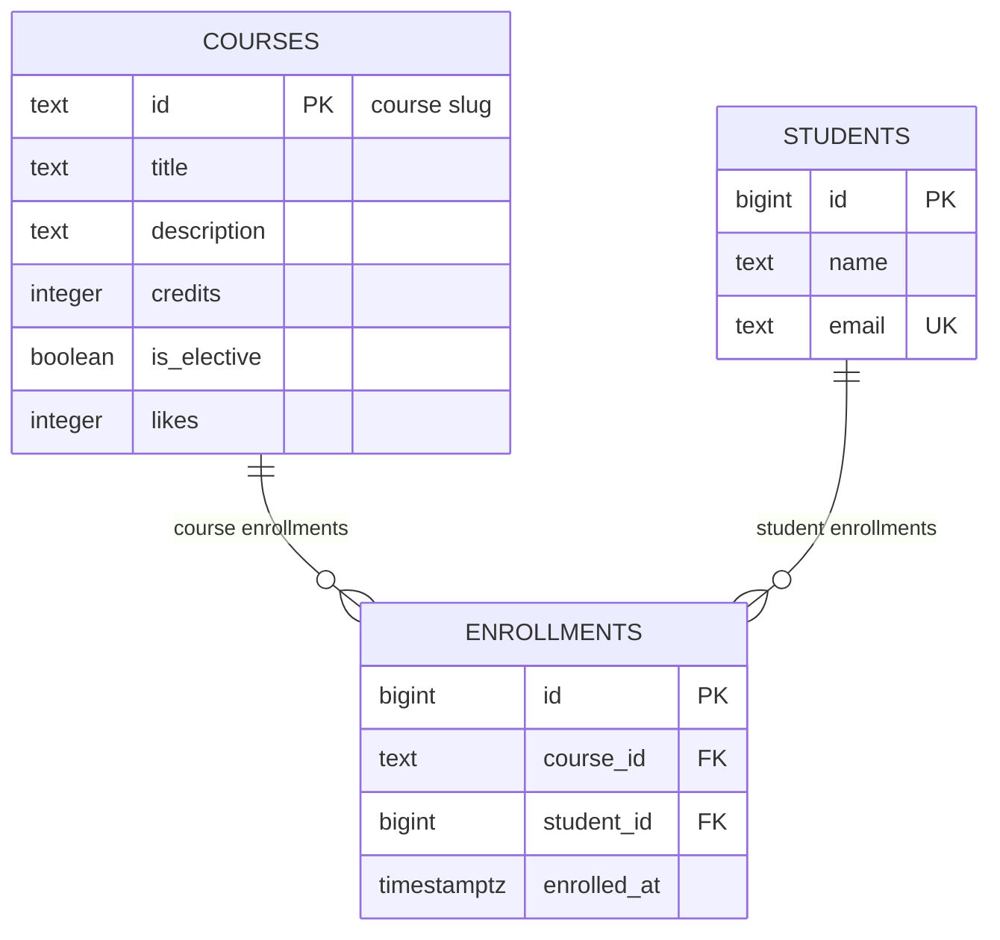

# course-catalog-db

PostgreSQL schema and query exercises for Lab 6, Advanced Web Technologies.

## How to run

Requires PostgreSQL 16 or newer and `psql`. As the PostgreSQL administrator, create the training role and databases (use a private password if this is not an isolated lab machine):

```sql
CREATE ROLE catalog_app LOGIN PASSWORD 'change-me';
CREATE DATABASE course_catalog OWNER catalog_app;
CREATE DATABASE idx_demo OWNER catalog_app;
CREATE DATABASE norm_demo OWNER catalog_app;
```

From this directory run:

```sh
psql -h localhost -U catalog_app -d course_catalog -v ON_ERROR_STOP=1 -f schema.sql
psql -h localhost -U catalog_app -d course_catalog -v ON_ERROR_STOP=1 -f seed.sql
psql -h localhost -U catalog_app -d course_catalog -v ON_ERROR_STOP=1 -f queries.sql
```

`schema.sql` rebuilds the teaching schema and deletes its tables. `seed.sql` truncates the teaching tables and resets identity counters. Do not point these scripts at production data.

## Schema



`courses` stores catalog entries and `students` stores student identity. `enrollments` links one student to one course, so it resolves the many-to-many relationship between courses and students. Each student/course pair is unique; deleting a course with enrollments is restricted, while deleting a student cascades to their enrollments.

## Design decisions

- `courses.id` is a readable, stable slug already used in URLs; a text key is convenient but a slug change requires updating references. `students.id` is an automatically generated bigint, which is compact and independent of a person's mutable name or email, but is not meaningful by itself.
- Course deletion uses `RESTRICT` so enrolled courses cannot silently disappear. Student deletion uses `CASCADE` so a deleted student's dependent enrollment rows do not become orphans.
- `timestamptz` stores an absolute moment and displays it in the session timezone; `timestamp` does not identify a timezone. `text` avoids an arbitrary maximum length; validation rules are expressed where they matter with NOT NULL, CHECK, and UNIQUE.

## Constraint violation log

The SQLSTATE and constraint names below are the expected PostgreSQL results for the Lab 6 commands. HTTP responses are the API mapping required for Lab 7; validate the SQLSTATEs on the local PostgreSQL version when running the experiments.

| # | What is violated | SQLSTATE | Constraint/field | API response |
|---|-----------------|----------|------------------|--------------|
| 1 | NULL in courses.title | 23502 | NOT NULL, column `title` | 422; request validation should catch it first |
| 2 | courses.credits = 0 | 23514 | `courses_credits_check` | 422 |
| 3 | courses.likes = -1 | 23514 | `courses_likes_check` | 500, an internal counter invariant failed |
| 4 | one-letter student name | 23514 | `students_name_check` | 422 |
| 5 | duplicate student email | 23505 | `students_email_key` | 409 Conflict |
| 6 | duplicate course id | 23505 | `courses_pkey` | 409 Conflict |
| 7 | repeated course/student enrollment | 23505 | `enrollments_course_id_student_id_key` | 409 Conflict |
| 8 | nonexistent course enrollment | 23503 | `enrollments_course_id_fkey` | 404 Course not found |
| 9 | nonexistent student enrollment | 23503 | `enrollments_student_id_fkey` | 404 Student not found |
| 10 | delete a course with enrollments | 23001 on PostgreSQL 18; 23503 on 16/17 | `enrollments_course_id_fkey` | 409 Conflict |
| 11 | delete a student with enrollments | no violation; cascade succeeds | `ON DELETE CASCADE` | 6 enrollments become 3; after ROLLBACK there are 6 |

Pydantic validation and database constraints serve different callers. The API validates requests early, while the database protects the same rules from scripts, administration tools, and any other application that writes to it.

## Index: EXPLAIN before and after

The experiment uses `idx_demo`, populated by `experiments/idx_data.sql` (500 courses, 20,000 students, 50,000 enrollments). The query is `SELECT * FROM enrollments WHERE student_id = 777;`.

Measured on the installed PostgreSQL 17.11 instance on 2026-10-28. The times depend on machine and cache state.

```text
Seq Scan on enrollments  (cost=0.00..1042.00 rows=3 width=34) (actual time=0.049..2.258 rows=3 loops=1)
  Filter: (student_id = 777)
  Rows Removed by Filter: 49997
Planning Time: 0.240 ms
Execution Time: 2.294 ms

Bitmap Heap Scan on enrollments  (cost=4.31..15.59 rows=3 width=34) (actual time=0.050..0.064 rows=3 loops=1)
  Recheck Cond: (student_id = 777)
  Heap Blocks: exact=3
  -> Bitmap Index Scan on enrollments_student_id_idx  (cost=0.00..4.31 rows=3 width=0) (actual time=0.033..0.033 rows=3 loops=1)
        Index Cond: (student_id = 777)
Planning Time: 0.471 ms
Execution Time: 0.135 ms
```

| | Before the index | After the index |
|---|---|---|
| Access method | Seq Scan | Bitmap Heap Scan + Bitmap Index Scan |
| estimated cost | about 0.00..1042.00 | about 4.31..15.59 |
| Rows Removed by Filter | about 49,997 | none; index condition locates matching rows |
| Execution Time | 2.294 ms | 0.135 ms |

1. A foreign key does not automatically create an index in PostgreSQL. The unique email and unique `(course_id, student_id)` constraints create indexes, and the latter can serve searches by its first column only.
2. A six-row `courses` table fits on one page, so a sequential scan can cost less than using its primary-key index. With 50,000 enrollment rows, scanning the whole table for one student's rows costs more than using an index.
3. The `student_id` index speeds up listing a student's enrollments and checking/deleting dependent enrollments during the `ON DELETE CASCADE` operation.

## Transaction

The failed example inserts a student and then tries to enroll them in a nonexistent course. PostgreSQL reports the foreign-key violation and marks the transaction aborted; after `ROLLBACK`, the first insert is gone as well. Without the transaction, that first insert would remain as a student with no intended enrollment.

In the successful two-window version, window B sees no uncommitted student before window A commits; after `COMMIT`, window B sees the student and the enrollment together. The isolation level is `read committed` by default. Keep transactions short because uncommitted changes can hold locks.

## Self-review against the checklist

| What to check | Result |
|---|---|
| Keys | Yes. Every table has a primary key; enrollments has foreign keys to both parent tables. |
| Types | Yes. Slug text, bigint identities, integer counts, boolean flag, and timestamptz enrollment time. |
| Required values | Yes. Required fields are NOT NULL; elective, likes, and enrollment time have defaults. |
| Constraints | Yes. CHECKs cover credits, likes, and name length; UNIQUE covers email and enrollment pair. |
| Deletion | Yes. Course deletion is RESTRICT; student deletion CASCADE is intentional. |
| Normalization | Yes. Student and course facts live in their own tables; enrollments stores references rather than duplicated names/titles. |
| Indexes and names | Yes. Primary/unique constraints and the student foreign-key index cover the required lookups; names follow PostgreSQL's snake_case conventions. |

## Bonus

### Normalization and anomalies

`experiments/norm_demo.sql` creates a flat registrations table in `norm_demo`. The update anomaly appears when only Daniyar's `modern-frontend` row is renamed: one course id then has two titles. The delete anomaly appears when deleting Daniyar's only `backend-fastapi` registration also removes the only stored copy of that course's title and credits. The insert anomaly appears when adding `web-security` without an enrollment: the row has to leave student columns empty because course facts have no independent place. Each experiment is wrapped in a transaction and rolled back.

Splitting the rows into `students`, `courses`, and `enrollments` stores student/course facts once and represents enrollment separately. The flat six registrations normalize to three students, three represented courses, and six enrollments; the three courses with no enrollments remain representable in `courses` independently.

### Lost update and row lock

Two clients can both read 11 likes and each write 12; one update is overwritten. `UPDATE courses SET likes = likes + 1` performs the increment using the current stored value. PostgreSQL locks the updated row: if client B waits while A's transaction is open, after A commits B continues against the fresh value and returns 13. Restore the counter to 11 after the manual two-window experiment.

### Parameters and SQL injection

Concatenating `x' OR '1'='1` into SQL changes the WHERE condition and can return every course. A prepared statement (`PREPARE by_id (text) AS SELECT id, title FROM courses WHERE id = $1;`) passes input as a value; `EXECUTE by_id('x'' OR ''1''=''1')` searches for that literal id and returns no rows. SQLAlchemy's bound parameters use this safe separation between SQL text and values.

### Additional queries

`queries.sql` includes the two optional exercises: the left-join/`IS NULL` query lists `api-design`, `databases-postgresql`, and `web-security`; the grouped `HAVING count(*) > 1` query reports Daniyar with 3 courses and Aigerim with 2.

### Email format rule

The final schema also has `students_email_format CHECK (position('@' IN email) > 1)`. PostgreSQL checks existing rows when this constraint is added with `ALTER TABLE`; the rule rejects a new email such as `no-at-sign`. It is declared in `schema.sql` so a clean rebuild includes the same rule.

## Live experiment status

The complete SQL workflow and bonus experiments were run against PostgreSQL 17.11. All ten constraint violations returned their expected SQLSTATE and constraint name; deleting the student cascaded from 6 to 3 enrollments, then ROLLBACK restored 6. Queries, normalization transfer, prepared-statement injection check, and before/after index plans all passed. The `course_catalog` database now has its original 6 courses, 3 students, and 6 enrollments.
